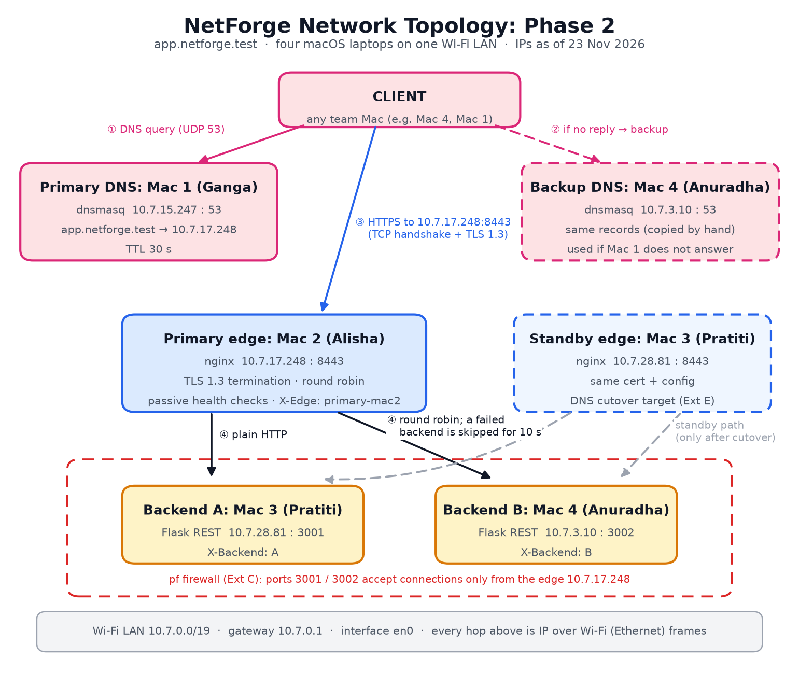

# NetForge: Private Network Service Platform

Computer Networks Course Project: **Phase 1** (Build and Observe) and **Phase 2** (Harden, Recover, Troubleshoot)

A private service environment built on four macOS laptops on one Wi-Fi LAN, with no cloud. A client opens
`https://app.netforge.test:8443`. The name is resolved by our own DNS server, the connection is made over TLS 1.3 to an nginx edge,
and the request is load balanced across two backend servers. Every step of that journey is captured in Wireshark.

In Phase 2 we added a backup DNS server, a 30-second DNS TTL, firewall isolation of the backends, automatic backend failover,
a standby edge reachable by DNS cutover, and a layer-by-layer troubleshooting script.

> The application stays simple. The network is the project.

## Team

| Member | Machine | Phase 1 role | Phase 2 addition |
|---|---|---|---|
| Ganga | Mac 1 | Primary DNS server + test client | TTL, record changes, troubleshooting drills |
| Alisha | Mac 2 | Edge: reverse proxy, load balancer, TLS | Health checks, failover, upstream logging |
| Pratiti | Mac 3 | Backend A | Standby edge, pf firewall on port 3001 |
| Anuradha | Mac 4 | Backend B + test client | Backup DNS, pf firewall on port 3002 |

## Project Demo Video

[Project Demo Video](https://drive.google.com/file/d/1UlZExhMh6v0b6dZ7keArF0XUAeVMysRz/view?usp=sharing)

## Architecture



```
Client
  → Private DNS (dnsmasq, UDP 53)          primary Mac 1, backup Mac 4, TTL 30 s
  → nginx edge (HTTPS, TCP 8443, TLS 1.3)  primary Mac 2, standby Mac 3
  → Backend A (Mac 3 :3001) / Backend B (Mac 4 :3002)   round robin, passive health checks
```

### Machines, IPs and services (re-verified 23 Nov 2026)

| Machine | IP | Service | Port(s) |
|---|---|---|---:|
| Mac 1 | 10.7.15.247 | Primary DNS (dnsmasq) | 53 |
| Mac 2 | 10.7.17.248 | nginx edge (HTTPS) | 8443 (also 80, not used in the demo) |
| Mac 3 | 10.7.28.81 | Backend A (Flask); standby nginx edge (Phase 2) | 3001; 8443 |
| Mac 4 | 10.7.3.10 | Backend B (Flask); backup DNS (Phase 2) | 3002; 53 |

Network `10.7.0.0/19` (mask 255.255.224.0), gateway `10.7.0.1`, interface `en0` (Wi-Fi).
The IPs come from DHCP and changed between Phase 1 and Phase 2, so re-check them with `ipconfig getifaddr en0` before every demo.

| DNS record | Points to | TTL |
|---|---|---|
| `app.netforge.test` | 10.7.17.248 (Mac 2, edge) | 30 s |
| `api.netforge.test` | 10.7.17.248 (Mac 2, edge) | 30 s |

Clients only ever learn the **edge** IP. The backend IPs are known only to nginx.

More detail:
- [`architecture/architecture.md`](architecture/architecture.md): full written architecture, resilience mechanisms, cloud equivalents
- [`architecture/IP_service_table.md`](architecture/IP_service_table.md): IPs, masks, gateway and MAC addresses
- [`architecture/request_flow_phase2.png`](architecture/request_flow_phase2.png): the request flow, layer by layer

## How one request works

| # | Step | Layer / protocol | Port |
|---|---|---|---|
| 1 | Client asks DNS for `app.netforge.test` (Mac 1; if no reply, Mac 4) | DNS over UDP | client ephemeral → 53 |
| 2 | DNS answers `10.7.17.248`, TTL 30 s; the client caches it | DNS | n/a |
| 3 | TCP three-way handshake (SYN, SYN-ACK, ACK) to the edge | TCP | client ephemeral → 8443 |
| 4 | TLS 1.3 handshake. Client Hello (SNI `app.netforge.test`) → Server Hello; the certificate is sent encrypted and checked against the trusted mkcert CA | TLS | 8443 |
| 5 | Encrypted `GET /api/status` (HTTP/1.1) | HTTP over TLS | 8443 |
| 6 | nginx ends TLS, picks a backend (round robin, skipping any marked down), forwards plain HTTP | HTTP | nginx → 3001 / 3002 |
| 7 | Backend replies with JSON + `X-Backend`; nginx adds `X-Edge` and `Cache-Control` | HTTP | n/a |

All of this travels as IP packets in Wi-Fi (Ethernet) frames on the same /19 subnet.

## Repository structure

| Folder | Contents | Owner |
|---|---|---|
| `architecture/` | Topology and request-flow diagrams (Phase 1 and Phase 2), IP/MAC table, written architecture | Ganga |
| `dns/` | Primary (`dnsmasq.conf`) and backup (`dnsmasq-backup.conf`) DNS configs, DNS notes | Ganga, Anuradha |
| `nginx/` | Edge configs: Phase 1 (`nginx.conf`), Phase 2 (`nginx-phase2.conf`), standby (`nginx-standby.conf`) | Alisha, Pratiti |
| `tls/` | mkcert certificate setup notes and script (no keys) | Alisha |
| `firewall/` | pf anchor rules for Mac 3 and Mac 4, apply and rollback steps | Pratiti, Anuradha |
| `backend-a/`, `backend-b/` | Backend source (Python, Flask) and run instructions | Pratiti, Anuradha |
| `tools/` | `diagnose.sh`: layer-by-layer troubleshooting | Everyone |
| `evidence/` | Screenshots, packet captures and test scripts, one folder per task | Everyone |
| `report/` | Phase 1 report (`NetForge Project Report.docx`), Phase 2 report (`NetForge_Phase2_Report.pdf`), earlier drafts | Everyone |
| `video/` | Demo video link | Everyone |
| `PHASE2_PLAN.md` | Phase 2 working plan and evidence checklist | Everyone |

## Setup

### 1. Backends (Mac 3 and Mac 4)

Both backends bind to `0.0.0.0`, so other Macs on the LAN can reach them.

```bash
cd backend-a      # or backend-b
python3 -m venv venv
source venv/bin/activate
pip install -r requirements.txt
python app.py     # Backend A listens on 3001, Backend B on 3002
```

| Endpoint | Response |
|---|---|
| `GET /` | `{"message": "Backend A is running"}` (or B) |
| `GET /api/status` | `{"backend": "A", "status": "ok"}` (or B) |
| Every response | Header `X-Backend: A` or `X-Backend: B` |

Keep each backend running in its own Terminal window for the whole demo.

### 2. DNS (Mac 1 primary, Mac 4 backup)

```bash
brew install dnsmasq
# copy dns/dnsmasq.conf (Mac 1) or dns/dnsmasq-backup.conf (Mac 4) to /opt/homebrew/etc/dnsmasq.conf
sudo brew services restart dnsmasq     # "restart", not "start": start does not reload a running service
dig @127.0.0.1 app.netforge.test       # expect 30 IN A 10.7.17.248
```

Point each client at both servers, primary first:

```bash
sudo networksetup -setdnsservers Wi-Fi 10.7.15.247 10.7.3.10
```

Records are copied by hand, so every record change must be made on **both** Mac 1 and Mac 4. Details: [`dns/README.md`](dns/README.md).

### 3. TLS certificate (Mac 2)

The certificate for `app.netforge.test` is issued by a local mkcert CA (`tls/generate-certs.sh`). Client Macs trust that CA, so
`curl` and browsers verify the certificate without `-k`. The standby edge on Mac 3 uses a **copy of the same certificate and key**
(SHA-256 fingerprint `7E:2E:AB:…:A9:C8`). Running mkcert on another Mac would create a CA no client trusts.
Details: [`tls/TLS_SETUP.md`](tls/TLS_SETUP.md).

### 4. nginx edge (Mac 2) and standby edge (Mac 3)

```bash
# Mac 2: copy nginx/nginx-phase2.conf to /opt/homebrew/etc/nginx/nginx.conf
nginx -t && brew services restart nginx

# Mac 3 standby (runs as root; its files are root-owned)
sudo nginx -t -c /opt/homebrew/etc/nginx/netforge-standby.conf
sudo nginx -c /opt/homebrew/etc/nginx/netforge-standby.conf
```

The Phase 2 edge config adds:
- `max_fails=1 fail_timeout=10s` on each backend
- `proxy_next_upstream error timeout http_502 http_503 http_504` and `proxy_next_upstream_tries 2`
- `proxy_connect_timeout 2s`
- `X-Edge` header and `Cache-Control: public, max-age=60`
- an upstream log at `/opt/homebrew/var/log/nginx/netforge_upstream.log`

Details: [`nginx/README.md`](nginx/README.md).

### 5. Backend firewall (Mac 3 and Mac 4, Phase 2)

The rules go in their own anchor file, `/etc/pf.anchors/netforge`, referenced from `/etc/pf.conf`, so Apple's system rules are never replaced.
We take a backup of `pf.conf`, do a dry run with `pfctl -vnf`, then load. Apply and rollback steps: [`firewall/README.md`](firewall/README.md).
The firewall was demonstrated and then **rolled back**, so it is **off** in the normal state.

## Verification

```bash
# DNS through our server
dig app.netforge.test

# Each backend directly (works only while the pf firewall is off)
curl -i http://10.7.28.81:3001/api/status
curl -i http://10.7.3.10:3002/api/status

# HTTPS through the edge (no -k flag)
curl -v https://app.netforge.test:8443/api/status

# Load balancing: X-Backend should alternate A and B
bash evidence/04_load_balancing/test-load-balancing.sh

# Caching: shows Cache-Control: public, max-age=60
bash evidence/06_caching/test-caching.sh

# Every layer at once: resolver, DNS, IP, TCP, TLS, HTTP (run on a client Mac)
bash tools/diagnose.sh
```

If `X-Backend` shows only one letter, the other backend is down. nginx is routing around it, which is the failover working.

## Phase 2 extensions and results

| Extension | What we did | Result | Evidence |
|---|---|---|---|
| A: Backup DNS | Second dnsmasq on Mac 4 with the same records; clients list Mac 1 then Mac 4; stopped Mac 1 | Names kept resolving from `SERVER: 10.7.3.10`; HTTPS still 200 | [`08_backup_dns`](evidence/08_backup_dns) |
| B: DNS TTL | `local-ttl=30`; changed a record while a client watched | Client used its cached old answer ~16 s longer than the server; a cache flush gave the new one in 1 s | [`09_dns_ttl`](evidence/09_dns_ttl) |
| C: Service isolation | pf anchor on Mac 3 and Mac 4: allow only 10.7.17.248 to 3001/3002 | Edge allowed, client timed out, HTTPS unaffected; rolled back | [`10_service_isolation`](evidence/10_service_isolation) |
| D: HA failover | nginx passive health checks + retry on the other backend | Backend A down → 10/10 requests served by B (200); A back → A/B again | [`11_ha_failover`](evidence/11_ha_failover) |
| E: Edge migration | Standby nginx on Mac 3; moved `app` to 10.7.28.81 on both DNS servers | Cached client stayed on Mac 2 ~29 s, then moved; every request 200; rolled back | [`12_edge_migration`](evidence/12_edge_migration) |
| F: Troubleshooting | `tools/diagnose.sh` + drills: DNS down, nginx down, TLS off, wrong upstream ports | Each fault found at the correct layer; one real 504 incident diagnosed | [`13_troubleshooting`](evidence/13_troubleshooting) |

**Remaining single point of failure:** the edge on Mac 2. Our mitigation is the standby edge plus a DNS cutover, which takes up to one TTL.
A floating IP shared by two edges (keepalived/VRRP), or a managed load balancer, would remove that wait.

## Evidence

| Folder | What it proves |
|---|---|
| [`evidence/00_lan`](evidence/00_lan) | Each Mac's current IP and pings to all four Macs |
| [`evidence/01_dns`](evidence/01_dns) | `dig` output and DNS query/response (Phase 1) |
| [`evidence/02_backend`](evidence/02_backend) | Both backends responding with `X-Backend` |
| [`evidence/03_https`](evidence/03_https) | Successful HTTPS request via the domain name |
| [`evidence/04_load_balancing`](evidence/04_load_balancing) | Requests alternating between A and B |
| [`evidence/05_wireshark`](evidence/05_wireshark) | Phase 1 screenshots, plus `phase2_full_flow.pcap` and `phase2_*` screenshots on the current IPs: DNS, TCP handshake, TLS 1.3 handshake, encrypted application data, `curl -v` |
| [`evidence/06_caching`](evidence/06_caching) | `Cache-Control: public, max-age=60` and a browser cache hit |
| [`evidence/07_failure`](evidence/07_failure) | One backend down and recovery, wrong DNS server, wrong record IP, both backends down (502), wrong port |
| [`evidence/08_backup_dns`](evidence/08_backup_dns) | Ext A: backup running, client lists both servers, primary stopped, names resolve through Mac 4, DNS failure vs app failure |
| [`evidence/09_dns_ttl`](evidence/09_dns_ttl) | Ext B: cached answer vs server answer timeline, flush |
| [`evidence/10_service_isolation`](evidence/10_service_isolation) | Ext C: pf anchor, dry run, rules loaded, edge allowed, client blocked, rollback |
| [`evidence/11_ha_failover`](evidence/11_ha_failover) | Ext D: Backend A down, all requests served by B, edge log retry, recovery |
| [`evidence/12_edge_migration`](evidence/12_edge_migration) | Ext E: standby test, DNS cutover, cached vs fresh client, standby log, rollback |
| [`evidence/13_troubleshooting`](evidence/13_troubleshooting) | Ext F: diagnose.sh baseline and drills (DNS, TCP, TLS, upstream), a real 504 incident, see `notes.md` |

## Protocol layers

| Layer | Protocol | Seen in |
|---|---|---|
| Application | DNS, HTTP/1.1, REST | `dig`, `curl -v`, Wireshark |
| Session / presentation (between transport and application) | TLS 1.3 | Client Hello / Server Hello in Wireshark, `curl -v` |
| Transport | TCP (8443, 3001, 3002), UDP (53) | Three-way handshake, ephemeral and fixed ports |
| Network | IPv4 | Client, DNS, edge and backend addresses in 10.7.0.0/19 |
| Link | Wi-Fi (802.11) / Ethernet framing | MAC addresses in the capture and in the IP table |

## Before a demo

1. Check every Mac's IP (`ipconfig getifaddr en0`). If one has changed, update the DNS records (both servers), the nginx upstreams and the pf rules.
2. Start both backends in Terminal windows that stay open.
3. On a client Mac, run `bash tools/diagnose.sh`. Every layer should PASS, with A and B alternating.

## Security note

No private keys or certificates are committed. `.gitignore` excludes `*.key`, `*-key.pem` and `*.pem`. The certificate and key stay in
`~/netforge-certs` on the edge Macs. Only configs, scripts, source code and evidence are in this repository.

## Reports

- Phase 1: [`report/NetForge Project Report.docx`](report/NetForge%20Project%20Report.docx)
- Phase 2: [`report/NetForge_Phase2_Report.pdf`](report/NetForge_Phase2_Report.pdf)

## Roadmap

- [x] Phase 1: Build and observe
- [x] Phase 2: Harden, recover and troubleshoot (see [`PHASE2_PLAN.md`](PHASE2_PLAN.md) and the [Phase 2 report](report/NetForge_Phase2_Report.pdf))
