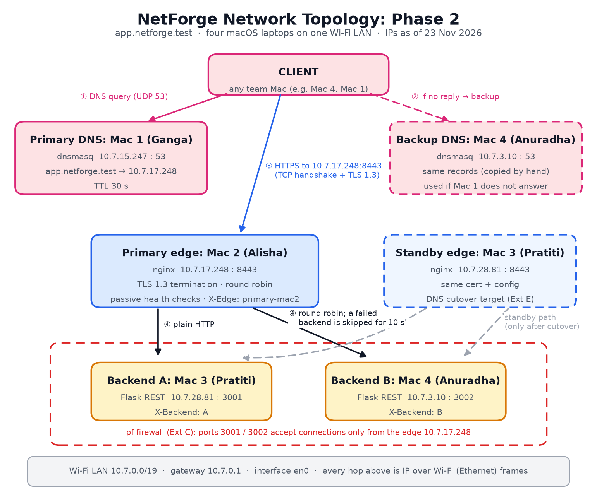
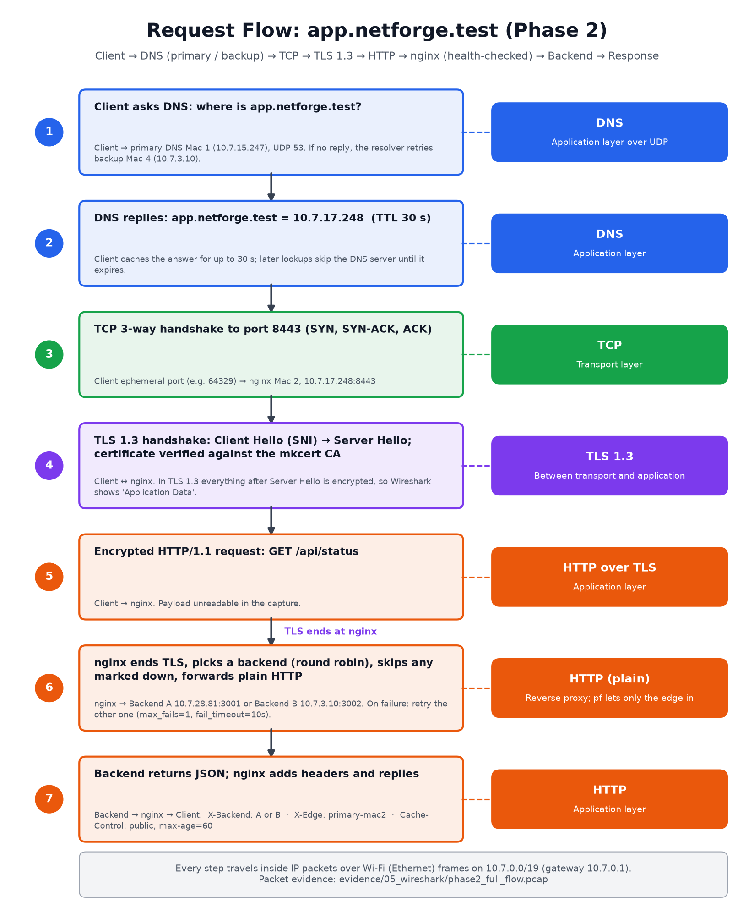

# NetForge Architecture (Phase 1 + Phase 2)

A private service platform on four macOS laptops on one Wi-Fi LAN (`10.7.0.0/19`, gateway `10.7.0.1`, interface `en0`).
A client opens `https://app.netforge.test:8443`. Our own DNS resolves the name, nginx terminates TLS at the edge,
and the request is load balanced across two Python backends. There is no cloud, and the network is the project.

### Phase 2 topology (current IPs)



### Phase 2 request flow



Phase 1 diagrams (older IP addresses, kept for reference): [`network_topology.png`](network_topology.png), [`request_flow.png`](request_flow.png).

## 1. Machines, roles and services

| Mac | Member | Phase 1 role | Phase 2 addition | IP (23 Nov 2026) | Services and ports |
|---|---|---|---|---|---|
| Mac 1 | Ganga | Primary DNS + test client | TTL 30 s, record changes | 10.7.15.247 | dnsmasq UDP/TCP 53 |
| Mac 2 | Alisha | Edge: reverse proxy, load balancer, TLS termination | Passive health checks, failover, `X-Edge` header, upstream log | 10.7.17.248 | nginx TCP 8443 (HTTPS), 80 |
| Mac 3 | Pratiti | Backend A | **Standby edge** (nginx, same cert), pf firewall on 3001 | 10.7.28.81 | Flask TCP 3001, standby nginx TCP 8443 |
| Mac 4 | Anuradha | Backend B + test client | **Backup DNS** (dnsmasq), pf firewall on 3002 | 10.7.3.10 | Flask TCP 3002, dnsmasq UDP/TCP 53 |

The IPs come from DHCP and changed between Phase 1 and Phase 2 (Mac 2, 3 and 4 all got new leases).
Re-check them with `ipconfig getifaddr en0` before every demo. See [`IP_service_table.md`](IP_service_table.md).

### DNS records (identical on both DNS servers)

| Name | Type | Value | TTL |
|---|---|---|---|
| app.netforge.test | A | 10.7.17.248 (Mac 2, primary edge) | 30 s |
| api.netforge.test | A | 10.7.17.248 | 30 s |

Clients only ever learn the **edge** IP. Backend IPs are known only to nginx.
Non-`.test` names are forwarded to 1.1.1.1 / 8.8.8.8, so clients keep normal internet access.

## 2. Phase 2 topology

```
                          Wi-Fi LAN 10.7.0.0/19  (gateway 10.7.0.1)
   ┌──────────────────────────────────────────────────────────────────────────────┐
   │                                                                              │
   │  Mac 1  10.7.15.247            Mac 4  10.7.3.10                              │
   │  ┌─────────────────────┐       ┌─────────────────────┐                       │
   │  │ PRIMARY DNS dnsmasq │       │ BACKUP DNS dnsmasq  │   clients list both:  │
   │  │ :53  + test client  │       │ :53                 │   1st Mac 1, 2nd Mac 4│
   │  └─────────────────────┘       └─────────────────────┘                       │
   │            │  app.netforge.test → 10.7.17.248 (TTL 30)                       │
   │            ▼                                                                 │
   │  Mac 2  10.7.17.248  PRIMARY EDGE          Mac 3  10.7.28.81  STANDBY EDGE   │
   │  ┌───────────────────────────────┐         ┌───────────────────────────────┐ │
   │  │ nginx :8443  TLS termination  │         │ nginx :8443  same cert/config │ │
   │  │ round robin + passive health  │         │ X-Edge: standby-mac3          │ │
   │  │ X-Edge: primary-mac2          │         │ (DNS cutover target, Ext E)   │ │
   │  └──────────────┬────────────────┘         └───────────────────────────────┘ │
   │                 │ plain HTTP (inside the LAN)                                │
   │       ┌─────────┴──────────┐                                                 │
   │       ▼                    ▼                                                 │
   │  Mac 3 Backend A :3001   Mac 4 Backend B :3002                               │
   │  pf: only 10.7.17.248    pf: only 10.7.17.248   (Ext C firewall boundary)    │
   └──────────────────────────────────────────────────────────────────────────────┘
```

## 3. Request flow, layer by layer

One request: `curl https://app.netforge.test:8443/api/status` from Mac 1.

| # | Step | Protocol / layer | Ports | What we observed |
|---|---|---|---|---|
| 1 | The client asks its resolver for `app.netforge.test` | DNS (application) over UDP | ephemeral → **53** | Answer `10.7.17.248`, TTL 30; `SERVER: 10.7.15.247` (or `10.7.3.10` if the primary is down) |
| 2 | ARP for the edge's MAC, then IP packets cross the Wi-Fi LAN | Ethernet/Wi-Fi (link), IPv4 (network) | n/a | Same /19 subnet, so traffic goes direct and doesn't pass through the router |
| 3 | TCP three-way handshake to the edge | TCP (transport) | ephemeral → **8443** | SYN, SYN-ACK, ACK in Wireshark |
| 4 | TLS 1.3 handshake. nginx presents the mkcert certificate (SAN `app.netforge.test`); the client trusts the mkcert CA | TLS (session / presentation) | 8443 | `SSL certificate verify ok`, TLSv1.3, AEAD-CHACHA20-POLY1305 |
| 5 | Encrypted HTTP/1.1 `GET /api/status` | HTTP (application) | 8443 | Wireshark shows only "Application Data" |
| 6 | nginx picks a backend (round robin, skips any marked down) and opens a **new** TCP connection | HTTP over TCP | ephemeral → **3001 / 3002** | `upstream=10.7.28.81:3001` in the edge log |
| 7 | The backend answers JSON with `X-Backend: A` or `B`. nginx adds `X-Edge` and `Cache-Control: public, max-age=60` | HTTP | n/a | `{"backend":"A","status":"ok"}` |

TLS ends at the edge. The edge-to-backend hop is plain HTTP inside the LAN; Ext C's firewall makes sure only the edge can use it.

## 4. Phase 2 resilience mechanisms

| Mechanism | Where | How it works | Cloud equivalent |
|---|---|---|---|
| Backup DNS (Ext A) | Mac 4 dnsmasq | Clients list two nameservers. If the first doesn't answer, the resolver retries the second. Records are kept the same **by hand** (no zone transfer). | Route 53 uses several anycast name servers per zone |
| Short TTL (Ext B) | `local-ttl=30` on both DNS servers | Clients cache an answer for at most 30 s. A record change reaches everyone within one TTL; flushing the cache picks it up immediately. | Lowering the TTL before a migration |
| Service isolation (Ext C) | pf anchor `/etc/pf.anchors/netforge` on Mac 3 and Mac 4 | `pass` from 10.7.17.248, then `block drop` from anyone else, for TCP to 3001/3002 only | Security groups that only allow traffic from the load balancer's security group |
| Passive health checks + failover (Ext D) | nginx upstream on Mac 2 | `max_fails=1 fail_timeout=10s`, `proxy_next_upstream error timeout http_502/503/504`, `proxy_next_upstream_tries 2`, `proxy_connect_timeout 2s` | ALB target health checks |
| Standby edge + DNS cutover (Ext E) | nginx on Mac 3 | Same cert and config. Moving the `app` A record from Mac 2 to Mac 3 sends new lookups to the standby within one TTL. | Route 53 failover records, or a multi-AZ load balancer |
| Layered diagnosis (Ext F) | [`tools/diagnose.sh`](../tools/diagnose.sh) | Resolver → DNS → IP → TCP → TLS → HTTP; the first FAIL is the faulty layer | Runbooks, synthetic monitoring |

### Remaining single points of failure

- **The primary edge (Mac 2).** If it dies, clients fail until DNS is cut over to Mac 3, and cached clients wait up to one TTL. A proper fix would be two edges sharing a floating IP (keepalived/VRRP), or anycast. Either removes the DNS wait.
- **Manual DNS sync.** Mac 1 and Mac 4 are edited separately. If one is forgotten, clients get different answers depending on which server they ask. Real setups replicate records automatically (AXFR/IXFR zone transfers, or a managed DNS service).
- **One Wi-Fi network and DHCP addresses.** A changed IP breaks the DNS records, the nginx upstreams and the pf rules at once. In production we'd use static IPs or DHCP reservations.

## 5. Ports and protocols

| Port | Proto | Service | Machines |
|---|---|---|---|
| 53 | UDP (TCP fallback) | dnsmasq | Mac 1, Mac 4 |
| 8443 | TCP (TLS) | nginx HTTPS | Mac 2 (primary), Mac 3 (standby) |
| 80 | TCP | nginx HTTP (Phase 1, not used in the demo) | Mac 2 |
| 3001 | TCP | Backend A (Flask) | Mac 3 |
| 3002 | TCP | Backend B (Flask) | Mac 4 |

We use 8443 instead of 443, which the brief allows. nginx on Mac 2 runs as a normal user (Homebrew LaunchAgent).

## 6. Configuration files

| File | Purpose |
|---|---|
| [`dns/dnsmasq.conf`](../dns/dnsmasq.conf) | Primary DNS (Mac 1) |
| [`dns/dnsmasq-backup.conf`](../dns/dnsmasq-backup.conf) | Backup DNS (Mac 4) |
| [`nginx/nginx.conf`](../nginx/nginx.conf) | Phase 1 edge |
| [`nginx/nginx-phase2.conf`](../nginx/nginx-phase2.conf) | Phase 2 edge with health checks and failover (Mac 2) |
| [`nginx/nginx-standby.conf`](../nginx/nginx-standby.conf) | Standby edge (Mac 3) |
| [`firewall/`](../firewall/) | pf anchor rules, apply and rollback |
| [`tls/`](../tls/) | Certificate creation and trust notes |
